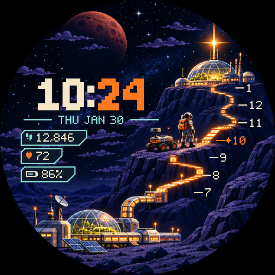

# Mars Watch

A pixel-art Mars watch face with time, date, steps, latest heart-rate sample,
battery, and an hour ladder. Four scenes share one Monkey C implementation.



| Target | Display | Approach |
| --- | --- | --- |
| `fenix9pro51mm` | 466 x 466 AMOLED, 128 KB face heap | Rich artwork when awake; sparse, shifting time when asleep |
| `fenix5x` | 240 x 240 MIP, 96 KB face heap | 16-color backgrounds, compact badges, alternate hour labels |

Targets the **AMOLED** 9 Pro, not Solar, and the original 5X, not 5X Plus.
The image above is a layout concept, not a simulator screenshot.

## On your Mac

```sh
./prerequisites.sh
./run.sh
```

Inspect the scripts first. In SDK Manager, sign in to Garmin, install a stable
SDK and the two device packages above, then select the current SDK.
`run.sh` asks whether to simulate, deploy over USB, do both, build, or export
a store package; no arguments are needed.

Builds live in ignored `bin/`; the private signing key lives in ignored
`.local/`. **Back up that key and reuse it for store updates.** Optional
`CIQ_SDK_HOME` and `CIQ_DEVELOPER_KEY` select an SDK or existing DER key.

For USB deployment, the 5X must mount with `GARMIN/APPS`. The 9 Pro uses MTP:
close other Garmin/MTP apps, connect one Garmin, and confirm the **51 mm**
AMOLED model (its reported name may omit the size). Transfers are verified
before replacing this face; no other apps are removed. Disconnect, then
select Mars Watch on the watch.

## Scenes and development

Automatic scenes use **local clock time**: dawn 05:00-08:00, day 08:00-17:00,
dusk 17:00-20:00, night otherwise, not astronomical sunrise/sunset.
The Scene setting pins a phase. Time respects 12/24-hour settings;
unavailable readings show `--`. There is no continuous sensor sampling.

`source/` contains the shared app and renderer; `art/` preserves the original
artwork. Device resources and fonts are included, so normal builds need no
Python. Regenerate artwork resources and run host tests with:

```sh
uv run --with pillow python tools/artwork.py
uv run --with pillow python -m unittest discover -s tests
```

Before release, check both devices, all phases, missing readings, and AMOLED
low-power heat-map/luminance behavior. Exporting `.iq` does not submit to the
store; artwork rights, screenshots, listing details, and Garmin review remain.

References: [Garmin setup](https://developer.garmin.com/connect-iq/connect-iq-basics/getting-started/),
[9 Pro device](https://developer.garmin.com/connect-iq/device-reference/fenix9pro51mm/),
[5X device](https://developer.garmin.com/connect-iq/device-reference/fenix5x/),
[AMOLED rules](https://developer.garmin.com/connect-iq/connect-iq-faq/how-do-i-make-a-watch-face-for-amoled-products/).
